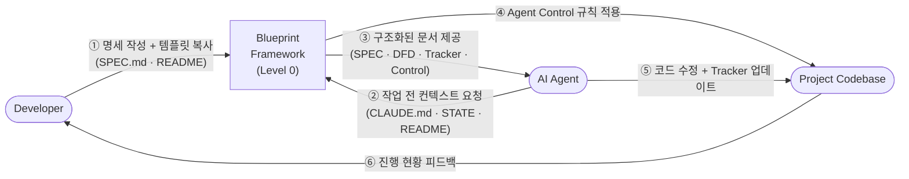

# Project Blueprint Framework

> AI 에이전트(Claude Code 등)가 프로젝트를 **정확하고 일관되게** 이해하고 수정할 수 있도록 설계된 문서 구조 표준입니다.

---

## DFD — Level 0 (Context Diagram)

> 이 레벨은 시스템 전체를 **하나의 프로세스**로 표현합니다. 외부 액터와 시스템 경계만 나타냅니다.  
> 하위 폴더의 README.md는 이 버블을 순차적으로 분해(Decompose)한 Level 1, Level 2 DFD를 가집니다.



### DFD 레벨 규칙 — 폴더 깊이가 아니라 "분해 깊이"

DFD 레벨은 **파일 시스템 깊이가 아니라, 소유자(최상위) README에서 몇 번 분해되었는가**로 정합니다.  
`README.md`가 없는 중간 폴더(예: `/src`처럼 묶음 역할만 하는 폴더)는 레벨을 소비하지 않습니다.

| 레벨 | 의미 | 예시 경로 | 표현 범위 |
|------|------|-----------|-----------|
| **Level 0** — Context | 소유자 폴더 (보통 루트) | `/README.md` | 시스템 전체, 외부 액터 경계 |
| **Level 1** — Main Processes | Level 0 버블 하나를 분해한 폴더 | `/templates/`, `/src/auth/` | 주요 서브시스템 |
| **Level 2** — Detailed Processes | Level 1 버블 하나를 분해한 폴더 | `/src/auth/handlers/` | 모듈 내부 흐름 |
| **Level 3+** — Function Level | Level 2 이하를 분해한 폴더 | `/src/auth/handlers/oauth/` | 함수/컴포넌트 수준 입출력 |

> **규칙**: 각 하위 DFD는 반드시 상위 DFD의 어느 버블을 분해한 것인지  
> `> Decomposed from: [상위 경로] Level N — [버블명] 버블` 로 명시해야 합니다.  
> 레벨 번호는 항상 **상위 README의 레벨 + 1**입니다.

---

## 왜 이 프레임워크가 필요한가?

AI 에이전트는 단일 파일 수준에서는 탁월한 성능을 보이지만,  
**프로젝트 전체 맥락(Context)** 을 유지하면서 작업할 때 다음 문제가 발생합니다:

- 무엇을 만들어야 하는지(완료 기준)가 불분명해 방향 없이 반복 수정
- 데이터 흐름을 오해해 의도치 않은 사이드 이펙트 발생
- 이미 구현된 기능을 중복 구현하거나 미구현 기능을 건너뜀
- 폴더별 아키텍처 원칙(Pure Function, 의존성 제한 등)을 무시

Blueprint Framework는 **명세(SPEC.md)로 "무엇을"을, 폴더별 `README.md`로 "어떻게"를** 정의합니다.  
에이전트가 작업 전 필요한 문서만 읽도록 강제해 위 문제를 구조적으로 차단합니다.

### 네 가지 핵심 장치

| 장치 | 위치 | 역할 |
|------|------|------|
| **SPEC (기능 명세)** | 루트 `SPEC.md` | 기능 ID(F-001)별 사용자 스토리와 **수용 기준** — "완료"의 정의 |
| **DFD (Data Flow Diagram)** | 각 폴더 `README.md` | 데이터 흐름을 시각화하여 흐름을 깨는 코드 작성 방지 |
| **Progress Tracker** | 소유자 `README.md` | 기능 ID별 구현 현황, 에이전트가 직접 업데이트 |
| **Agent Control** | 각 폴더 `README.md` | 폴더별 행동 제약 — 에이전트의 폴더 수준 System Prompt |

세 문서는 **기능 ID 하나로 연결**됩니다:

```
SPEC.md  F-003 (수용 기준)  ──▶  README.md Tracker  F-003 (상태 · Owner Folder)  ──▶  /src/auth/README.md (DFD · Agent Control)
```

---

## 레포지토리 구조

```
project-blueprint-framework/              ← Level 0 DFD (Context)
├── README.md                             # 이 파일 (Level 0 DFD 포함)
├── BLUEPRINT.md                          # 프레임워크 전체 명세 (Level 1 DFD) — 세션 중 읽지 않음
├── CONTRIBUTING.md                       # 에이전트 행동 강령 · 세션 프로토콜
├── CHANGELOG.md                          # 프레임워크 변경 이력
└── templates/                            ← Level 1 DFD
    ├── README.md                         # templates 폴더 설명 (Level 1 DFD 포함)
    │
    │   ── 명세 ──
    ├── SPEC_TEMPLATE.md                  # → 프로젝트 루트 SPEC.md (기능 명세 · 수용 기준)
    │
    │   ── 폴더 README ──
    ├── README_TEMPLATE_TOP.md            # 소유자 폴더용 (Tracker · Roadmap 보유)
    ├── README_TEMPLATE_SUB.md            # 하위 폴더용 (Context · DFD · Agent Control)
    ├── FOLDER_CHECKLIST.md               # 새 폴더 생성 체크리스트
    ├── README_TEMPLATE.md                # (폐기 예정) 구버전 범용 템플릿
    │
    │   ── 에이전트 세션 ──
    ├── CLAUDE_TEMPLATE.md                # → 프로젝트 루트 CLAUDE.md (매 세션 자동 로딩)
    ├── AGENT_BOOTSTRAP.md                # 최초 1회 초기화 후 삭제
    ├── AGENT_STATE.md                    # 세션 간 상태 인계 파일
    ├── AGENT_STATE_ARCHIVE.md            # STATE 압축 시 보관소
    │
    │   ── 가이드 ──
    ├── FIRST_PROMPTS.md                  # 프로젝트 유형별 첫 프롬프트
    ├── MIGRATION_GUIDE.md                # 기존 프로젝트 적용 가이드
    └── AGENT_SESSION_GUIDE.md            # 토큰·세션 운용 전략
```

---

## 빠른 시작

### 1. 새 프로젝트에 적용

프로젝트 루트에 아래처럼 배치합니다:

| 복사할 파일 | 프로젝트에서의 이름 |
|---|---|
| `templates/SPEC_TEMPLATE.md` | `SPEC.md` |
| `templates/README_TEMPLATE_TOP.md` | `README.md` |
| `templates/CLAUDE_TEMPLATE.md` | `CLAUDE.md` |
| `templates/AGENT_BOOTSTRAP.md` | `AGENT_BOOTSTRAP.md` |
| `CONTRIBUTING.md`, `templates/` 폴더 | 그대로 (`AGENT_STATE.md`는 초기화 때 BOOTSTRAP이 templates에서 복사) |

### 2. SPEC.md를 먼저 채운다

최소한 **개요, MVP 범위, 기능 목록(F-ID), MVP 기능의 수용 기준**은 사람이 직접 채웁니다.  
나머지 섹션은 에이전트와 함께 채워도 됩니다.

### 3. Claude Code 첫 세션

```
이 프로젝트는 Blueprint Framework를 따릅니다.
CLAUDE.md의 세션 시작 프로토콜을 실행해 (AGENT_BOOTSTRAP.md가 있으니 초기화부터).
초기화 후 SPEC.md의 기능 목록으로 루트 README.md Progress Tracker를 채우고,
Level 0 DFD를 작성해.
```

프로젝트 유형별 프롬프트는 [`templates/FIRST_PROMPTS.md`](./templates/FIRST_PROMPTS.md),  
기존 코드베이스라면 [`templates/MIGRATION_GUIDE.md`](./templates/MIGRATION_GUIDE.md)를 참고하세요.

---

## 핵심 원칙

1. **"무엇을"은 SPEC.md, "얼마나 됐나"는 소유자 Tracker, "어떻게"는 폴더 README** — 각각 한 곳에서만 정의한다
2. **에이전트는 작업 전 해당 기능의 SPEC 항목과 담당 폴더 `README.md`를 읽는다**
3. **수용 기준을 모두 통과해야 `✅ Done`이다**
4. **구조 변경 시 `DFD`를 최신 상태로 유지한다**

자세한 규칙은 [CONTRIBUTING.md](./CONTRIBUTING.md) 및 [BLUEPRINT.md](./BLUEPRINT.md)를 참고하세요.
