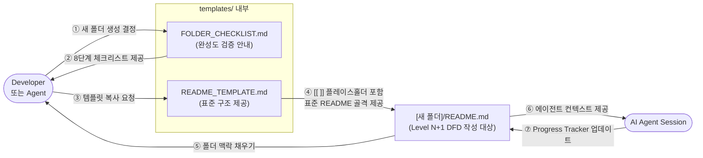

# templates — Overview

프로젝트 내 모든 폴더에서 재사용하는 **Blueprint Framework 표준 템플릿 파일**을 보관합니다.  
새 폴더 생성 시 이 폴더의 파일을 복사해 사용하며, 에이전트가 일관된 문서 구조를 생성하도록 안내합니다.

---

## DFD — Level 1 (Main Processes)

> Decomposed from: `/` Level 0 — `Blueprint Framework` 버블  
> 루트의 단일 버블 중 **"문서 구조 제공(Template Provision)"** 프로세스를 분해합니다.

---

## Tech Stack

- Markdown (CommonMark)
- mermaid (다이어그램 렌더링)

---

## Agent Control

> 이 섹션의 규칙은 에이전트가 `templates/` 폴더를 수정할 때 **반드시** 따라야 합니다.

### 허용 (Allow)

- `README_TEMPLATE.md` 내 플레이스홀더(`[[ ]]`) 구조 유지 하에 내용 보완
- `FOLDER_CHECKLIST.md`에 체크 항목 추가
- 기술 스택별 특화 템플릿 파일 추가 (예: `README_TEMPLATE_REACT.md`)

### 금지 (Prohibit)

- `README_TEMPLATE.md`의 섹션 순서 변경 금지 (Overview → DFD → Tech Stack → Agent Control → Tracker → Roadmap)
- DFD 레벨 표시(`## DFD — Level [N]`) 헤더 형식 임의 변경 금지
- `Decomposed from:` 줄 삭제 금지

### 필수 (Required)

- 템플릿 구조 변경 시 `BLUEPRINT.md §2`도 함께 업데이트
- 새 템플릿 파일 추가 시 이 `README.md`의 Progress Tracker에 반영
- DFD 수정 시 루트 `README.md`의 Level 0 DFD와 일관성 검토

---

## Progress Tracker

| Feature | Status | Assignee | Last Updated | Notes |
|---------|--------|----------|--------------|-------|
| README_TEMPLATE.md 기본 구조 | ✅ Done | Agent | 2026-05-18 | 레벨링 표기 포함 |
| FOLDER_CHECKLIST.md | ✅ Done | Agent | 2026-05-18 | 5가지 검증 질문 포함 |
| 기술 스택별 특화 템플릿 | ⏳ Pending | - | - | React / Python / Node.js 등 |

---

## Next Roadmap

1. React 프로젝트용 특화 템플릿 (`README_TEMPLATE_REACT.md`) 작성
2. Python 데이터 파이프라인용 특화 템플릿 작성
3. `FOLDER_CHECKLIST.md`에 DFD 레벨 일관성 검증 항목 추가
